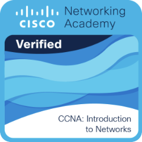

<div align="center">



<a href="https://www.instagram.com/kristianfrimer"></a>
<a href="https://www.linkedin.com/in/kristi%C3%A1n-frimer-5692703aa/"></a>
<a href="https://www.facebook.com/kristian.frimer"></a>
<a href="mailto:kristianfrimer@outlook.com"></a>

<br /><br />





</div>

<br />

### `❯ cat about.swift`

I'm an **IT student at SPŠE Prešov** (Secondary Technical School of Electrical Engineering) and the **founder of OutfititLab**. I love turning ideas into polished, real-world apps — from native macOS and iOS tools to cross-platform mobile products.

```swift
struct Kristian: Developer {
    let name      = "Kristián Frimer"
    let school    = "SPŠE Prešov · IT"
    let startup   = "OutfititLab"          // founder 🚀
    let location  = "Slovakia 🇸🇰"

    let languages = ["Swift", "JavaScript", "Python", "Java", "HTML", "CSS"]
    let focus     = ["SwiftUI", "React Native", "AI-powered apps"]
    let certified = ["CCNA ITN", "CCNA SRWE", "IT Essentials", "Linux Essentials"]
    let values    = ["clean architecture", "smooth animations", "premium design"]

    func currentlyBuilding() -> String {
        "AI Overlay — a floating AI assistant for macOS"
    }
}
```

### `❯ open ./startup/outfititlab`

<table>
  <tr>
    <td colspan="3" align="center">
      <h3>👗 OutfititLab</h3>
      <p><i>Organize your wardrobe. Find the best outfit for the day.</i></p>
      <p>
        
        
        
        
        
      </p>
    </td>
  </tr>
  <tr>
    <td width="33%" valign="top" align="center">
      <b>📸 Digital closet</b><br />
      <sub>Snap or import your clothes and sort them into categories in seconds.</sub>
    </td>
    <td width="33%" valign="top" align="center">
      <b>✨ Outfit generator</b><br />
      <sub>Casual, sport, outdoor or elegant — get a look for any occasion.</sub>
    </td>
    <td width="33%" valign="top" align="center">
      <b>📊 Wardrobe insights</b><br />
      <sub>Saved looks, outfit history and stats about what you actually wear.</sub>
    </td>
  </tr>
</table>

### `❯ ls ~/projects --featured`

> These projects live in private repositories — happy to show more on request.

<table>
  <tr>
    <td width="50%" valign="top">
      <h3>🤖 AI Overlay</h3>
      <p><sub><code>macOS</code> · in active development</sub></p>
      <p>A floating AI assistant that appears above every app — even full-screen — with a single global shortcut.</p>
      <ul>
        <li>15+ providers: OpenAI, Anthropic, Gemini, OpenRouter, Ollama…</li>
        <li>Side-by-side model comparison</li>
        <li>Live token &amp; cost tracking with price estimates before sending</li>
        <li>Answer versions, conversation branches and quick actions on selected text</li>
      </ul>
      <p>
        
        
        
        
      </p>
    </td>
    <td width="50%" valign="top">
      <h3>👔 Lyrra</h3>
      <p><sub><code>iOS</code> · AI stylist</sub></p>
      <p>A premium wardrobe companion — not an inventory tool, but a personal styling studio that lives on your phone.</p>
      <ul>
        <li>Photo-based digital closet with wear tracking</li>
        <li>AI outfit generator for mood, occasion &amp; weather</li>
        <li>Color analysis and seasonal transitions</li>
        <li>Style score, streaks, badges and an evolution timeline</li>
      </ul>
      <p>
        
        
        
        
      </p>
    </td>
  </tr>
</table>

### `❯ which --all stack`

<p align="center">
  
</p>

| | |
|---|---|
| **🍎 Apple** | `Swift` `SwiftUI` `SwiftData` `AppKit` `Xcode` |
| **📱 Mobile** | `React Native` `Expo` `iOS` `Android` |
| **🌐 Web** | `HTML5` `CSS` `JavaScript` `Node.js` |
| **💻 Languages** | `Python` `Java` |
| **📡 Networking** | `Cisco` `Linux` `Routing & Switching` |
| **🧰 Tools** | `Git` `GitHub` `Figma` |

### `❯ ls ~/certs`

<p align="center"><sub>Earned through <b>Cisco Networking Academy</b> at SPŠE Prešov</sub></p>

<table align="center">
  <tr>
    <td width="25%" valign="top" align="center">
      <br />
      <b>CCNA: Switching, Routing &amp; Wireless Essentials</b><br />
      <sub>Mar 2026 · 70 hours</sub>
    </td>
    <td width="25%" valign="top" align="center">
      <br />
      <b>Linux Essentials</b><br />
      <sub>May 2025 · 70 hours</sub>
    </td>
    <td width="25%" valign="top" align="center">
      <br />
      <b>CCNA: Introduction to Networks</b><br />
      <sub>Jun 2024</sub>
    </td>
    <td width="25%" valign="top" align="center">
      <br />
      <b>IT Essentials: PC Hardware &amp; Software</b><br />
      <sub>Jun 2024</sub>
    </td>
  </tr>
</table>

### `❯ tail -f ~/now.log`

```diff
+ building   AI Overlay — a native AI assistant for macOS
+ growing    my startup OutfititLab
+ studying   IT at SPŠE Prešov
+ exploring  how AI can make everyday apps smarter
! ask me     about Swift, SwiftUI, React Native or app design
```

### `❯ ping kristian`

Have an idea, a project or just want to say hi? Write me at **[kristianfrimer@outlook.com](mailto:kristianfrimer@outlook.com)** or reach out on [LinkedIn](https://www.linkedin.com/in/kristi%C3%A1n-frimer-5692703aa/).

<div align="center">
<br />

</div>
